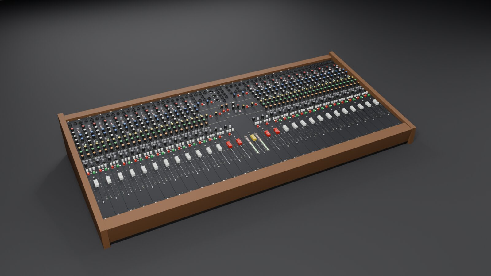
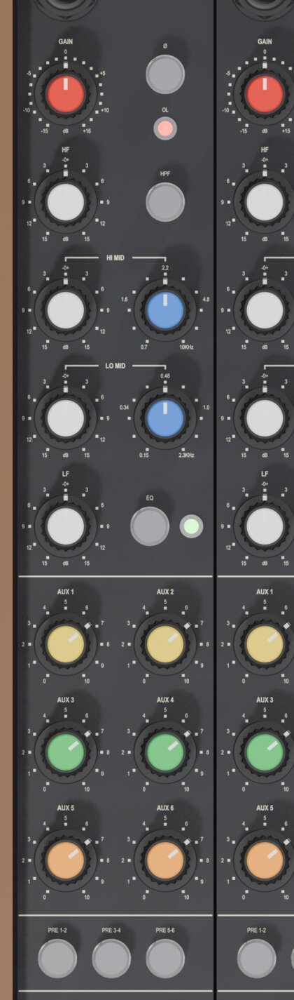
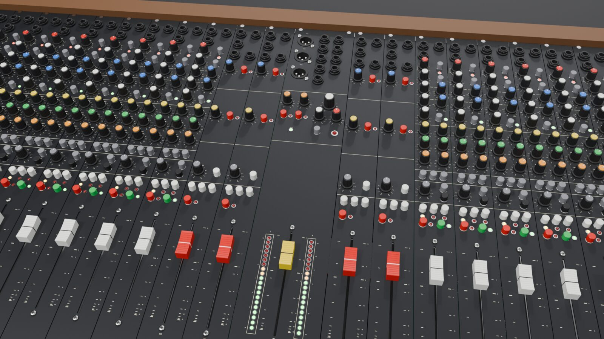
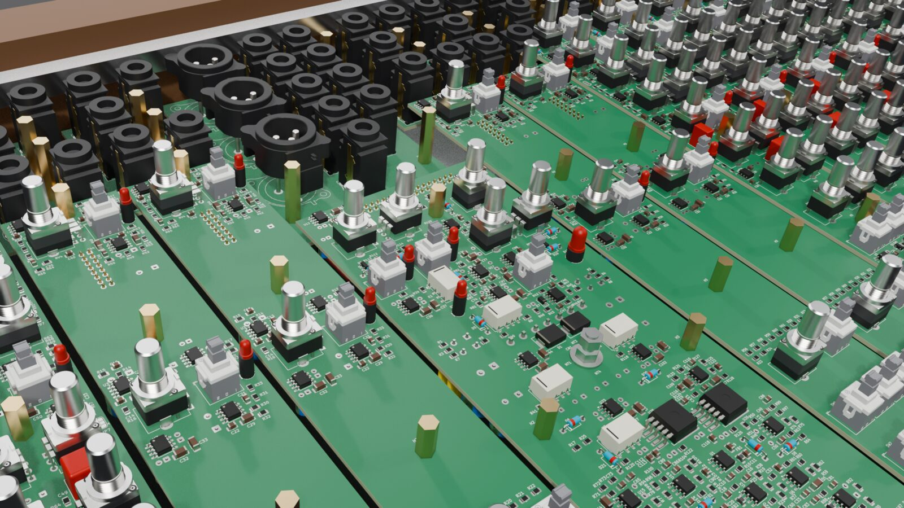

# goa-console

A DIY line-level mixing console with 24 or more channels, in the style of the Soundcraft Delta and meant for mixing
hardware synths (goa trance). It is designed in KiCad. Python generates the schematics, which are checked against
intended netlists and simulated in ngspice.

> **Design only, not built.** No board here has been routed, fabricated or powered, so nothing is proven on the bench.
> The external PSU connects to mains, so build it only if you are qualified to work with mains voltages. See
> [Licence](#licence): there is no warranty of any kind.



*3D model built from the placed KiCad boards (`tools/console_3d.py`). Knob caps and panel finish are placeholders.*

## What it is

- **Modules on a motherloom.** Each channel is a Delta Theatre input without the mic stage:
  - one 8 HP × 12U panel with two boards: a 38 × 400 mm main board and a 38 × 43 mm jack board;
  - every module plugs into a daisy-chained 34-way IDC ribbon that uses the Delta's own motherloom pinout, one ribbon
    per wing of 12 strips;
  - the 16 HP master module sits in the centre with both wing headers and the power entry; the four 8 HP group
    modules sit next to it, two on each wing.
- **Channel strip** (spec v5.7):
  - a buffered differential line receiver (OPA1656 followers) and an inverting line gain stage, −15…+15 dB with a
    centre detent;
  - a Ø switch and a sweepable 21–403 Hz high-pass filter (KHN);
  - the Delta's four-band EQ, except that the two swept mid bands are rebuilt as KHN state-variable band-pass
    filters, so a stocked A10K dual pot tunes them;
  - an insert after the EQ, ON (a JFET soft mute that also mutes the pre-fade sends and the direct out) and PFL;
  - a 100 mm fader with a +10 dB post-amp, then pan and routing to L-R, 1-2 and 3-4 through DG413 switches at the
    bus end of each 4K7 summing resistor;
  - six aux sends, with one PRE switch per pair of sends (solder jumpers pick its source: pre-fader or pre-EQ) and a
    DIR switch that makes the aux 6 pot the level of the direct out.
- **Master:**
  - mix summing referenced to a ground-cancel line, each sum followed by a re-inverter;
  - DRV135UA (DRV134 family) balanced outputs with mute relays, plus a power-on mute;
  - mono, PFL and AFL monitoring, 20-LED meters on each side, and the masters for aux 5 and 6.
- **Groups:** each has a sub bus with insert and pan, two stereo returns and an aux master (aux n on group n).
- **Power:** an external supply giving ±17 V at 4 A per rail. Two isolated Mean Well LRS-150-24 modules each feed a
  floating rail with its own LC filter, LM1084 regulator and SCR crowbar. A 7-pin XLR carries the supply to the
  console.

<table>
<tr>
<td></td>
</tr>
<tr>
<td><em>Strip panel print in the Delta's style</em></td>
</tr>
</table>




## Status

| Part | Schematic | Placement | Routing |
|------|-----------|-----------|---------|
| Channel strip (main + jack board) | done, verified, simulated | done | to do |
| Group module ×4 (main + jack board) | done, verified | done | to do |
| Master module (main + jack board) | done, verified | done | to do |
| External PSU | done, verified, simulated | done | to do |
| Test jig (master stub + load board) | done, verified | done | to do |

- **Component placement only.** The boards are generated by the placer and carry no tracks, vias or zones; copper
  routing is done by hand in KiCad (see `AGENTS.md`). Unrouted connections are expected.
- **What the checks show:**
  - parity DRC finds 0 schematic-parity issues on every board;
  - the strip, group and master main boards and both jig boards have 0 DRC violations;
  - the jack boards report only items inside KiCad's NJ6FD-V footprint, and the PSU only 20 known TO-220 silk-edge
    items (the tabs overhang the board edge by design);
  - `python3 tools/check_all.py` runs every check in one go (netlist against intended, pins against footprints, ERC,
    parity DRC, footprint links, route_check, the simulations and the rule tests) and exits non-zero on any failure.
- **Still open:**
  - the bench checks from the master parts review (`docs/reviews/master_parts_review.md`, signed off and applied 2026-10-23):
    re-inverter stability, aux noise, relay release and mains-off timing, PFL tick, meter current-source temperature;
  - check the panel parts against samples:
    - fader pad pattern (1:1 print) and which side of the slot the pins sit;
    - fader law, which the printed dB scale needs;
    - fader-cap fit on the blade;
    - panel stack height;
    - PV cap clearance;
    - knob fit;
  - check the pan pot (ALPS RK09L1240015, chosen 2026-10-25) and the PVA2 latch orientation on samples;
  - route the boards;
  - build the test jig with four routed strips and run its bus tests (`test_jig_spec.md`); some bus decisions wait on
    them;
  - build the 12U frame (`frame/`, FR1-FR3) and the PSU case (`psu_case/`, PC1-PC3: Hammond 1402KV, Fischer SK 47 75 SA).

  The details are in `CLAUDE.md`, "Not done / open" and "Next steps".

## Repository layout

| Path | What |
|------|------|
| `console_architecture.md` | Whole-console architecture (authoritative): bus pinout, grounding, power, op-amp choices |
| `channel_strip_schematic_spec.md`, `docs/reviews/strip_parts_review.md` | Strip component-level spec v5.7 (authoritative), including panel parts and stack (§16); the stability and ratings review behind v4.1 |
| `master_section_spec.md`, `docs/studies/master_panel_study.md`, `docs/reviews/master_parts_review.md` | Master and group modules: functions, parts, panel study, review of the proposed parts |
| `psu_spec.md`, `test_jig_spec.md` | External PSU, test jig |
| `docs/studies/delta_clone_comparison.md`, `docs/studies/strip_panel_study.md` | Why the strip is a Delta clone, why 8 HP × 12U with two pot columns |
| `docs/build/panel_parts_drawings.md`, `docs/build/panel_print.md` | Panel parts against their manufacturers' drawings; the Delta's panel legend system and ours |
| `boards/<name>/` | One folder per KiCad project, nine in all (`channel_strip`, `jack_board`, `group`, `group_jack_board`, `master`, `master_jack_board`, `jig_master_stub`, `jig_load_board`, `psu`). Each holds the generated schematic (`.kicad_sch`, with `*_sheets/` for the hierarchical ones) and placed board (`.kicad_pcb`), `.kicad_pro`, `.kicad_dru`, the netlist `.net`, `_intended.json`, and its own `fp-lib-table` / `sym-lib-table` pointing at the project libraries in the repository root |
| `boards/channel_strip/` | The strip's main board: `channel_strip.kicad_pro` opens it with the schematic. The old v3.1 board is `archive/channel_strip_v3.1.kicad_pcb` |
| `docs/` | The design record: `proposals/`, `reviews/`, `studies/`, `build/` (sourcing, samples, escape plan, panel print), `decisions.md`, `verification_log.md`, `tooling.md`, and `INDEX.md`, the map of all of it |
| `pdf/*.pdf`, `bom/*_BOM.csv` | Schematic PDF and BOM exports; `bom/` also holds the order lists. The netlists (`.net`) and `*_intended.json`, the netlists the schematics are checked against, live in each board's folder |
| `goa-console.pretty/`, `goa-console.3dshapes/`, `goa-console.kicad_sym` | Project footprints (faders, spade tab, PTC), part 3D models (VRML + STEP), symbols |
| `tools/` | Generators, verification (`check_all.py` runs everything), placement engine, routing rules (`netrules.py`), fab outputs (`fab_out.py`), the order list (`order_bom.py`), 3D export and Blender build (below) |
| `sim/` | ngspice decks and Python sims: signal path, EQ, gain stage, mid tuning, routing switch, master mix, meters, mute, PSU |
| `ref/` | **Not in this repository.** It holds third-party documents: the Soundcraft Delta DLX/Theatre schematics, the 200 Delta Technical Manual and User Guide with panel-drawing crops, the Mackie 1604-VLZ service manual and an API 500 spec. The docs still cite them by their `ref/...` paths. The folder is git-ignored, so a local copy stays out of commits |
| `render/` | 3D exports (`*.json`); renders and the `.blend` are generated and git-ignored |
| `CLAUDE.md` | Working notes: rules, current state, one-line decisions, open items; the detail in `docs/INDEX.md` (file map, proposals table), `docs/tooling.md`, `docs/decisions.md` (decisions in full), `docs/verification_log.md` |

## Toolchain

- KiCad 10.0.7: `kicad-cli`, plus its bundled Python 3.9 for `pcbnew` (placement and 3D export).
- Python 3 with a `.venv` holding kiutils 1.4.8 (the schematic generators).
- ngspice 46.
- Blender 5.2, optional (3D model and renders).

On macOS:

```bash
KC=/Applications/KiCad/KiCad.app/Contents/MacOS/kicad-cli
KPY=/Applications/KiCad/KiCad.app/Contents/Frameworks/Python.framework/Versions/3.9/bin/python3
python3 -m venv .venv && .venv/bin/pip install kiutils==1.4.8
```

## Working on it

The schematics are generated: edit the generator, then regenerate and verify every schematic it writes. For the
strip:

```bash
# writes boards/channel_strip/channel_strip.kicad_sch and boards/jack_board/jack_board.kicad_sch
.venv/bin/python tools/gen.py boards/channel_strip/channel_strip.kicad_sch
for s in channel_strip jack_board; do
  $KC sch export netlist -o $s.net $s.kicad_sch
  .venv/bin/python tools/verify.py $s.net ${s}_intended.json
  # symbol pins vs footprint pads
  python3 tools/check_fp.py $s.net
  $KC sch erc --severity-all $s.kicad_sch
done
# strip only: both netlists joined by the ribbon, simulated in ngspice
python3 tools/sim_netlist.py boards/channel_strip/channel_strip.net boards/jack_board/jack_board.net
```

The whole console (24 strips, 4 groups and the master, each with its jack board, on the ribbon) is simulated from the
generated netlists with `python3 tools/sim_console.py` (45 checks, about a minute; `--list` names them). It covers
levels, routing, mutes, PFL, returns, EXT, crosstalk, ground currents and noise. Regenerate the netlists first.

The other generators work the same way:

| Generator | Writes |
|-----------|--------|
| `gen_group.py boards/group/group.kicad_sch` | group, group_jack_board |
| `gen_master.py boards/master/master.kicad_sch` | master, master_jack_board |
| `gen_psu.py` (no argument) | psu |
| `gen_jig.py` (no argument) | jig_master_stub, jig_load_board |

Run the export / verify / check_fp / ERC steps for each schematic in the right-hand column.

Simulations: each deck in `sim/` runs its own analyses, e.g. `ngspice -b sim/strip_v4.cir` (the v4.0 strip model; the
current strip is checked from its netlist by `sim_netlist.py`, 45 checks). `python3 sim/mid_tuning.py 10e3` compares the
mid-band tunings for a given pot value (the 2026-10-22 tuning; the v5.5 ranges come from `sim/review/eqmid/measure.py`).

Placement only. The strip, group and master main boards have four layers, with a solid ground plane and a ground fill
inside (`docs/studies/layer_study.md`); every other board has two. Each script refuses to overwrite a board that
already has routing:

```bash
# strip main board + jack board
tools/build_strip_pcb.sh
# group, master (~3 min) and their jack boards
$KPY tools/place_group.py
$KPY tools/place_master.py
$KPY tools/place_jig.py
$KPY tools/place_psu.py
```

Each run prints a placement report: decoupler-to-supply-pin distances and the reach of high-impedance input
networks. Every board is its schematic's project board, so parity DRC runs in place
(`$KC pcb drc --schematic-parity --severity-all X.kicad_pcb`). After any re-placement or netlist change, re-run
`$KPY tools/netrules.py` (net classes and the `.kicad_dru` rules). `python3 tools/fab_out.py BOARD` writes Gerbers,
drills, position file and BOM to `fab/BOARD/` once a board is routed; `python3 tools/order_bom.py` builds the
console-wide order list from the BOMs.

Part models and the 3D console:

```bash
# part models vs footprints; writes goa-console.3dshapes
python3 tools/models3d/check.py --wrl --kicad
# placed boards to JSON, one file per module
$KPY tools/export_3d.py boards/channel_strip/channel_strip.kicad_pcb boards/jack_board/jack_board.kicad_pcb > render/strip.json
$KPY tools/export_3d.py boards/group/group.kicad_pcb boards/group_jack_board/group_jack_board.kicad_pcb > render/group.json
$KPY tools/export_3d.py boards/master/master.kicad_pcb boards/master_jack_board/master_jack_board.kicad_pcb > render/master.json
# builds render/goa_console.blend and renders the views
BLENDER=/Applications/Blender.app/Contents/MacOS/Blender
$BLENDER -b --factory-startup --python tools/console_3d.py -- render
```

## Conventions

- **Generated files are not edited by hand:** schematics, boards, footprints and 3D models. Change the generator
  (`tools/gen*.py`, `tools/master_lib.py`, `tools/place_*.py`, `tools/footprints.py`, `tools/models3d/`) and
  regenerate.
- **Decisions are recorded with their date** in `CLAUDE.md` ("Decisions made") and in the specs. Changing one is a
  deliberate step, not a side effect.
- **The Delta schematics are the circuit reference.** Where this design departs from them, the reason is in
  `docs/studies/delta_clone_comparison.md` or the spec.

## Licence

Copyright 2026 Ruslan Migirov. Licensed under the [CERN Open Hardware Licence Version 2, Strongly Reciprocal](LICENSE)
(`SPDX-License-Identifier: CERN-OHL-S-2.0`). It covers the whole repository including `tools/`, because the generators
there hold the design itself: the netlists, the schematic drawings and the placement. The design is provided as is, with
no warranty of any kind.

Not covered by that licence:

- SPICE model parameters under `sim/` that come from component manufacturers remain theirs.
- Standard KiCad library footprints and 3D models used by the boards stay under the KiCad libraries' own licence.

Soundcraft, Delta, Mackie and API are trademarks of their respective owners. This project is not affiliated with or
endorsed by any of them.
