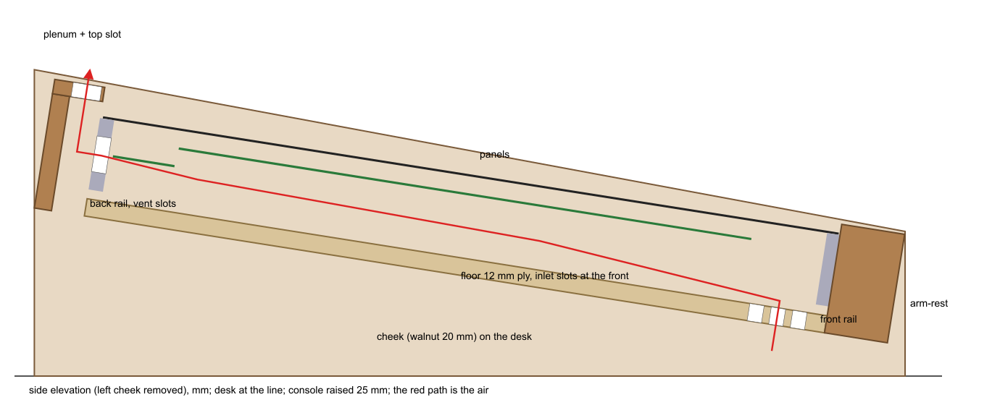

# Tub: proposal (2026-10-26)

The tub is the woodwork that holds the frame rails, carries the 9° tilt and closes the console underneath. The 3D
model has placeholder boxes for it. What it now has to do:
- **Rails:** take the two 10 × 50 rails in rebates, 2 mm deep, with 2 × M4 per end (`frame_proposal.md`).
- **Vents:** carry `thermal_study.md` TH1, inlet slots in the floor inside the front rail and a plenum behind the back
  rail with a top slot.
- **Power:** take the console's NC7MD-LX power inlet. Master spec §24 puts it on the rear panel, which on this console
  is the back trim.
- **Clearances:** clear everything below the panels. The floor's top stays 45 mm under the main boards, as the model
  has it.

*Side elevation with the near cheek removed: the red path is the air, in under the front of the floor and out through
the back rail's slots and the plenum.*

## Two findings from the geometry

1. **The front of the floor sits on the desk in the model.** With the model's mounting, the floor's underside at the
   front is 4.9 mm above the desk, so the floor inlet slots would get no air. **Raising the console 25 mm** (taller
   cheeks) gives 30 mm under the front of the floor and puts the panels' front edge 99 mm above the desk (was 74), a
   normal console height.
2. **The model's back trim is too thin for a plenum.** At y −40…−12 it leaves a 15 mm channel behind the rail, 0.018 m²
   over the width; the vent path needs 0.024 m². **Back trim at y −48…−13:** a 12 mm rear wall leaves a 23 mm channel,
   0.027 m².

## Proposal

**TB1. Construction.** Woods and joints are defaults; change them freely, the dimensions are what matter.

| Part | Qty | Material | Size (mm) | Notes |
|---|---|---|---|---|
| Cheek | 2 (mirror) | walnut, 20 | about 601 deep × 212 high at the back, 100 at the front | carries the tilt; stands on the desk on felt pads; 10 × 50 × 2 rebates for the rails, 2 × Ø4.5 counterbored per rail end; 6 mm dados for the floor |
| Floor | 1 | birch ply, 12 | 1235.2 × 517 | in the cheeks' dados; inlet slots (TB2) |
| Arm-rest | 1 | walnut | 1223.2 × 44 × 76 | between the cheeks, dowelled and screwed from outside; front edge rounded |
| Plenum rear wall | 1 | walnut, 12 | 1223.2 × about 80 | the console's rear panel: NC7MD-LX cut-out (TB3) |
| Plenum top cap | 1 | walnut, 10 | 1223.2 × 35 | the outlet slot (TB2) |

**TB2. Air path.**
- **Inlet:** three rows of 10 mm slots in the floor at y 455 / 470 / 485, inside the front rail. They are 100 mm long
  with 15 mm bridges, about 0.031 m² open, with fine mesh stapled underneath. The space under the floor stays open front
  and back between the cheeks, with no base panel; the front opening under the arm-rest is about 30 mm × 1.22 m.
- **Outlet:** the back rail's 30 slots (already in its drawing) into the 23 mm plenum channel, then a 22 × 1180 mm slot
  in the top cap with bridges every 300 mm (about 0.024 m² open). The slot faces up and back, away from the engineer.

**TB3. Power inlet.**
- **Inlet:** the NC7MD-LX (D-size: Ø24 plus 2 × M3) in the plenum's rear wall behind the master (console x ≈ 610).
- **Cable:** it enters the cavity through the back rail's slot 14 (console x ≈ 590, 30 × 25 mm; the 7 × 1.0 mm²
  wires are fine there), then runs along the floor to the master's J1. The 3D model's cable now takes that route
  instead of passing under the rail, where there is only 6.5 mm.
- **Earth:** pin 1 still reaches the star through J1's CHASSIS conductor, so nothing else changes.

**TB4. Drawings and model.**
- **Generator:** `tools/tub_fab.py` → `tub/`: cheek profiles (with rebates, dados and screw holes), floor (slots), arm-rest,
  plenum parts, a cut list and an A3 PDF. They come from the same `panel_layout` numbers as the rails and panels.
- **3D model:** the tub raised 25 mm, the base wedge removed (open under the floor), the plenum, the floor slots and the
  cable route.

## Sign-off

Signed off by Ruslan on 2026-10-26: TB1–TB4 as proposed.

- [x] **TB1** Construction as tabled: walnut cheeks, arm-rest and plenum; 12 mm ply floor in dados.
- [x] **TB2** Floor inlet slots plus open underside; plenum outlet slot.
- [x] **TB3** NC7MD-LX in the plenum rear wall, cable through back-rail slot 14.
- [x] **TB4** Generate the tub drawings and update the 3D model (raised 25 mm).

## Applied (2026-10-26)

- **Shared geometry:** `panel_layout.py` holds the tub's numbers (`to_desk()`, `cheek_outline()`, `inlet_slots()` and the
  floor / arm-rest / plenum constants). They are shared by `tools/tub_fab.py` and the 3D model.
- **Plenum outlet, changed while drawing:** a 22 mm slot cut into a 35 mm cap would have left a 0.5 mm sliver. The cap is
  now a 14 mm strip on the rear wall, and the whole top of the 21 mm channel in front of it is the outlet:
  21 × 1223 mm, 0.026 m² (≥ 0.024).
- **`tools/tub_fab.py` → `tub/`:**
  - `cheek.dxf`: the left cheek's outside face, with rail rebates, floor dado and counterbored screw holes; the right
    cheek is its mirror;
  - `floor.dxf`: 30 inlet slots 100 × 10 in three rows, 0.030 m²;
  - `armrest.dxf`, `rear_wall.dxf` (NC7MD-LX cut-out at x 610.3), `cap.dxf`;
  - `cutlist.csv` and an A3 `tub.pdf`.

  The script checks every cheek feature against the outline, the NC7 against the rear wall, the floor clearance under
  the rails and the outlet area.
- **3D model:**
  - raised 25 mm (`MOUNT_Z` 165), with no base wedge;
  - the cheeks from the shared outline;
  - the floor built with its slots (4 strips, 33 bridges);
  - the arm-rest, the plenum rear wall and cap, and the NC7MD-LX on the rear wall;
  - the supply cable from the NC7 through back-rail slot 14 and along the floor to J1.

  Checked in renders: a section through the master, the empty tub, and the floor slots from above.
